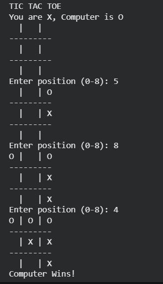

<h1>ExpNo 7 : Implement Alpha-beta pruning of Minimax Search Algorithm for a Simple TIC-TAC-TOE game</h1> 
<h3>Name: GOMATHI G </h3>
<h3>Register Number:212225230079</h3>
<H3>Aim:</H3>
<p>
Implement Alpha-beta pruning of Minimax Search Algorithm for a Simple TIC-TAC-TOE game
</p>
<h1>GOALS of Alpha-Beta Pruning in MiniMax Search Algorithm</h1>

<h3>Improve the decision-making efficiency of the computer player by reducing the number of evaluated nodes in the game tree.</h3>
<h3>Tic-Tac-Toe game implementation incorporating the Alpha-Beta pruning and the Minimax algorithm with Python Code.</h3>
<h1>IMPLEMENTATION</h1>

The project involves developing a Tic-Tac-Toe game implementation incorporating the Alpha-Beta pruning with the Minimax algorithm. Using this algorithm, the computer player analyzes the game state, evaluates possible moves, and selects the optimal action based on the anticipated outcomes.

<h1>The Minimax algorithm</h1>

recursively evaluates all possible moves and their potential outcomes, creating a game tree.

<h1>Alpha-Beta pruning</h1>

Alpha–Beta (𝛼−𝛽) algorithm is actually an improved minimax using a heuristic. It stops evaluating a move when it makes sure that it’s worse than a previously examined move. Such moves need not to be evaluated further.

When added to a simple minimax algorithm, it gives the same output but cuts off certain branches that can’t possibly affect the final decision — dramatically improving the performance
<hr>
<h2>Sample Input and Output:</h2>


# PROGRAM:
```

# Alpha-Beta Pruning in Tic-Tac-Toe

board = [' ' for i in range(9)]

def print_board():
    for i in range(0, 9, 3):
        print(board[i], '|', board[i+1], '|', board[i+2])
        if i < 6:
            print("---------")

def check_winner():
    win = [
        [0,1,2], [3,4,5], [6,7,8],
        [0,3,6], [1,4,7], [2,5,8],
        [0,4,8], [2,4,6]
    ]

    for a, b, c in win:
        if board[a] == board[b] == board[c] != ' ':
            return board[a]
    return None

def minimax(alpha, beta, is_max):
    winner = check_winner()

    if winner == 'O':
        return 1
    if winner == 'X':
        return -1
    if ' ' not in board:
        return 0

    if is_max:
        best = -100

        for i in range(9):
            if board[i] == ' ':
                board[i] = 'O'
                score = minimax(alpha, beta, False)
                board[i] = ' '

                best = max(best, score)
                alpha = max(alpha, best)

                if beta <= alpha:
                    break

        return best

    else:
        best = 100

        for i in range(9):
            if board[i] == ' ':
                board[i] = 'X'
                score = minimax(alpha, beta, True)
                board[i] = ' '

                best = min(best, score)
                beta = min(beta, best)

                if beta <= alpha:
                    break

        return best

def computer_move():
    best_score = -100
    move = -1

    for i in range(9):
        if board[i] == ' ':
            board[i] = 'O'
            score = minimax(-100, 100, False)
            board[i] = ' '

            if score > best_score:
                best_score = score
                move = i

    if move != -1:
        board[move] = 'O'

def play_game():
    print("TIC TAC TOE")
    print("You are X, Computer is O")

    while True:
        print_board()

        pos = int(input("Enter position (0-8): "))

        if pos < 0 or pos > 8 or board[pos] != ' ':
            print("Invalid position! Try again.")
            continue

        board[pos] = 'X'

        if check_winner() == 'X':
            print_board()
            print("You Win!")
            break

        if ' ' not in board:
            print_board()
            print("Draw!")
            break

        computer_move()

        if check_winner() == 'O':
            print_board()
            print("Computer Wins!")
            break

        if ' ' not in board:
            print_board()
            print("Draw!")
            break

play_game()
```
# OUTPUT:



# Result :

We have successfully implemented Alpha-beta pruning of Minimax Search Algorithm for a Simple TIC-TAC-TOE game.